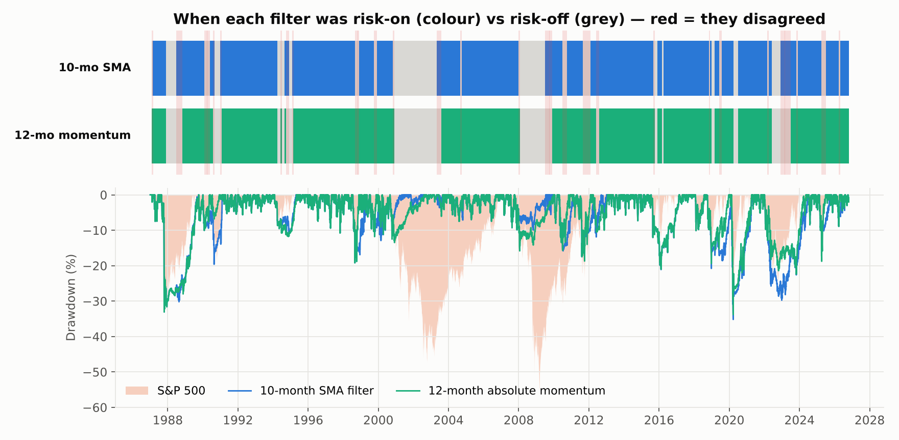

# 10-month SMA trend filter — backtested

Strategy Lab article #2. Mebane Faber's moving-average rule: each month, hold equities if the S&P 500's
month-end close is above its 10-month simple moving average, otherwise hold US aggregate bonds. Put head
to head with the 12-month absolute momentum filter from [article #1](https://github.com/AlgoStrategyLab/dual-momentum).

**Backtest:** Jan 1987 – Oct 2026 (39.8 years) · VFINX / VBMFX · monthly rebalance · next-close execution ·
10 bps costs · price history loaded from 1980 so the average is defined from the first evaluated month.

| | 10-mo SMA | 12-mo absolute momentum | S&P 500 |
| --- | --- | --- | --- |
| CAGR | 9.38% | 10.61% | 11.24% |
| Sharpe | 0.71 | 0.77 | 0.67 |
| Max drawdown | –35.2% | –33.8% | –55.2% |
| Signal switches | 48 | 27 | 0 |
| Annual turnover | 239% | 133% | 3% |
| Growth of $1 | $35 | $55 | $69 |



## Key findings

- **The two filters agree on 88% of months**, including every major bear market. The disagreements are
  thin slivers at regime changes, and neither side is reliably right in them.
- **The gap is trading friction, not judgement.** The SMA switches 48 times to momentum's 27 (209-day vs
  371-day average holding period) and gives up ~1.2 points a year to whipsaw.
- **10 months is close to the worst setting tested.** Every length from 12 to 16 months produced a higher
  return, a higher Sharpe *and* less turnover. At 16 months: 11.27% CAGR.
- **A 3% hysteresis band recovers most of the gap** — 9.38% → 10.68%, turnover 239% → 128%.
- **No help in fast crashes.** Through Black Monday 1987 both filters lost 24.1% against the index's 19.5%:
  fully invested into the crash, then selling at the month-end bottom.
- **Walk-forward *helped* here** (9.27% vs 8.47% fixed), unlike in article #1 — the parameter surface has a
  real gradient rather than being noise.

## Reproduce

```bash
pip install -r requirements.txt     # installs the shared engine from AlgoStrategyLab/strategylab-core
python run.py                       # fetches Yahoo data (cached in ./data), writes output/*.json (~3 min)
python make_charts.py               # renders output/c*.png
python site_build/make_tables.py    # renders the article's table images
```

## Files

| File | What it is |
| --- | --- |
| `strategy.py` | `SmaTrendFilter`, plus `AbsoluteMomentum` and `CombinedFilter` for the comparison |
| `run.py` | Main run, signal-agreement analysis, disagreement episodes, lookback and band sweeps, cost sensitivity, in/out-of-sample split, walk-forward |
| `make_charts.py` | The five article charts |
| `output/sma_trend_filter_main.json` | Full run, schema v1.1 |
| `output/sma_trend_filter_summary.json` | Every robustness and comparison result in the article |
| `output/signals.csv` | Monthly risk-on/risk-off state for both filters |

Article: **[Read it here](https://algostrategylab.github.io/sma-trend-filter/)**.
Engine: [strategylab-core](https://github.com/AlgoStrategyLab/strategylab-core).

MIT licensed. Research and education only, not investment advice.
